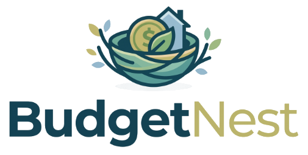

# BudgetNest 🪺

<p align="center">
  
  <br>
  <strong>A modern, responsive personal budget and wealth planner designed to nurture your financial health.</strong>
  <br><br>
  <a href="https://mohamadaarishm.github.io/budget-planner/"><strong>🌐 View Live Website</strong></a>
</p>

---

## 🌟 Key Features

1. **Dashboard (`/`)**
   - **Header & Greeting:** "Good morning, Mohamad Aarish", unified October 2026 month picker, global "+ Add Transaction" action.
   - **5 Summary Cards:**
     - **Monthly Budget:** ₹50,000 (Target set by user)
     - **Income:** ₹47,000 (₹42,000 salary + ₹5,000 freelance, `+5% MoM`)
     - **Expenses:** ₹19,280 (Sum of October expense records)
     - **Budget left:** ₹30,720 (`Monthly budget − expenses`)
     - **Net this month:** +₹27,720 (`Income − expenses`, monthly surplus)
   - **Account Balance Strip:** Displays true account balance (₹77,720 = Starting Balance ₹50,000 + Net this month ₹27,720) with interactive Starting Balance setup.
   - **Cash Flow Bubbles:** Circular visualization comparing Income (purple bubble), Expenses (dark bubble), and Budget Left (neon lime bubble) alongside key category micro-progress bars.
   - **Dark Accent Runway Card:** Obsidian night card featuring Budget remaining (**₹30,720**), progress (**38.6%**), and a textured daily spending runway bar chart highlighting peak spending days (e.g. Oct 2 rent, groceries, bills) in neon lime.
   - **Category Spending & Recent Activity:** Direct category breakdown and the latest 5 transactions with instant category-filtered navigation.

2. **Transactions (`/transactions`)**
   - Live search by description and category.
   - Multi-criteria filtering by Month, Type (All, Expense, Income), and Category.
   - Sorting options: Newest first, Oldest first, Largest amount.
   - Desktop responsive data table with formatted currency, category badges, and quick actions.
   - Mobile stacked card view.
   - Add/Edit modal with dynamic category filtering by type and validation.
   - Delete confirmation dialog with an **Undo** toast action.

3. **Budgets (`/budgets`)**
   - Monthly budget target card with interactive edit modal and large visual progress bar.
   - Individual category spending limits cards for:
     - **Housing:** ₹15,000 limit | ₹15,000 spent | ₹0 left (Maxed out warning)
     - **Food & Dining:** ₹10,000 limit | ₹2,680 spent | ₹7,320 left
     - **Transport:** ₹5,000 limit | ₹210 spent | ₹4,790 left
     - **Utilities:** ₹4,000 limit | ₹460 spent | ₹3,540 left
     - **Shopping:** ₹5,000 limit | ₹540 spent | ₹4,460 left
     - **Health:** ₹3,000 limit | ₹150 spent | ₹2,850 left
     - **Entertainment:** ₹4,000 limit | ₹240 spent | ₹3,760 left
     - *(Total category limits: ₹46,000)*
    - Visual warnings and badges if limits are approached, reached, or exceeded.

4. **Reports & Analytics (`/reports`)**
   - Summary banner: Total Income, Total Expenses, and Net Monthly Surplus (**+₹27,720**).
   - Interactive SVG **Donut Chart** with hover tooltips and category percentage rankings.
   - **Income vs Expenses** comparison bar visualization.
   - Full-width October daily spending timeline.
   - Export CSV report button.

5. **Settings & Preferences (`/settings`)**
   - Currency configuration (Indian Rupee `₹ INR`, `USD $`, `EUR €`, `GBP £`) with integer minor unit handling (paise).
   - Starting account balance configuration.
   - Category management (add, edit icons, categorize as income/expense).
   - Start of week preference (Monday / Sunday).
   - Full Data Export: Backup as JSON and Export as CSV.
   - Reset to October 2026 Reference Seed Data button.
   - Complete data wipe with safety confirmation.

6. **Multi-User Login & Account Switching**
   - Seamless authentication modal supporting **Sign In** and **Create Account**.
   - Isolated per-user storage: each user maintains their own transactions, budget limits, salary, and categories.
   - Quick 1-click demo accounts switchable directly from the top-bar profile dropdown:
     - **Mohamad Aarish** (`mohamadaarish.m@budgetnest.app`) - Full October 2026 reference seed dataset.
     - **Sarah Jenkins** (`sarah.j@budgetnest.app`) - Starter personal budget.
     - **Priya Sharma** (`priya.s@budgetnest.app`) - Independent student budget.

7. **Salary & Income Editing**
   - Dedicated **Edit Monthly Salary** modal accessible directly from:
     - The **Income summary card** badge (`✏️ Edit Salary`).
     - The **Cash Flow bubble** widget.
     - The top-bar **Profile dropdown menu**.
     - The **Settings** page (*Account & Income Setup* section).
   - Features quick amount presets (`₹40k`, `₹42k`, `₹45k`, `₹50k`, `₹60k`) and raise percentage buttons (`+5%`, `+10%`).
   - Stored as integer minor units (paise) with instant recalculation of Available Balance, Monthly Net Surplus, and Reports.

8. **Quick Search & Command Palette**
   - Hit **`⌘K`** or click the search pill to open the instant search palette.

---

## 📐 Formulas & Calculations

| Metric | Sample Value | Calculation Formula |
|---|---|---|
| **Monthly Budget** | ₹50,000 | Set by the user |
| **Income** | ₹47,000 | ₹42,000 salary + ₹5,000 freelance |
| **Expenses** | ₹19,280 | Sum of October expense transactions |
| **Budget left** | ₹30,720 | `Monthly budget − expenses` |
| **Net this month** | +₹27,720 | `Income − expenses` (Monthly surplus savings) |
| **Starting Balance** | ₹50,000 | Opening bank account balance |
| **Actual Account Balance** | ₹77,720 | `Starting balance + Net this month` (`Starting balance + Income − Expenses`) |
| **Progress** | 38.6% | `(Expenses / Monthly Budget) * 100` |

*All amounts are stored internally as integer minor units (paise), where ₹1 = 100 paise.*

---

## 🚀 Running the Application

### 1. Python REST API & SQLite Server (Active)
The built-in server runs on Python 3 and includes the `/api/v1` REST endpoints and SQLite database persistence:
```bash
python3 server.py
```
Open **[http://localhost:8000](http://localhost:8000)** in your browser.

### 2. Direct Browser Viewing
You can also open `index.html` directly in any modern web browser. The app runs fully client-side with complete `localStorage` persistence and automatic seed data initialization.

---

## 🗄️ Backend REST API (`/api/v1`)

- `GET /api/v1/health` — Service health check
- `GET /api/v1/transactions` — Query transactions with filtering and pagination
- `POST /api/v1/transactions` — Create new income/expense record
- `DELETE /api/v1/transactions/:id` — Delete transaction
- `GET /api/v1/budgets/:month` — Fetch monthly & category budgets
- `GET /api/v1/reports/summary?month=2026-10` — Calculate mathematical aggregates
- `GET /api/v1/reports/by-category?month=2026-10` — Expense breakdown by category
- `GET /api/v1/export?format=csv|json` — Export financial records
